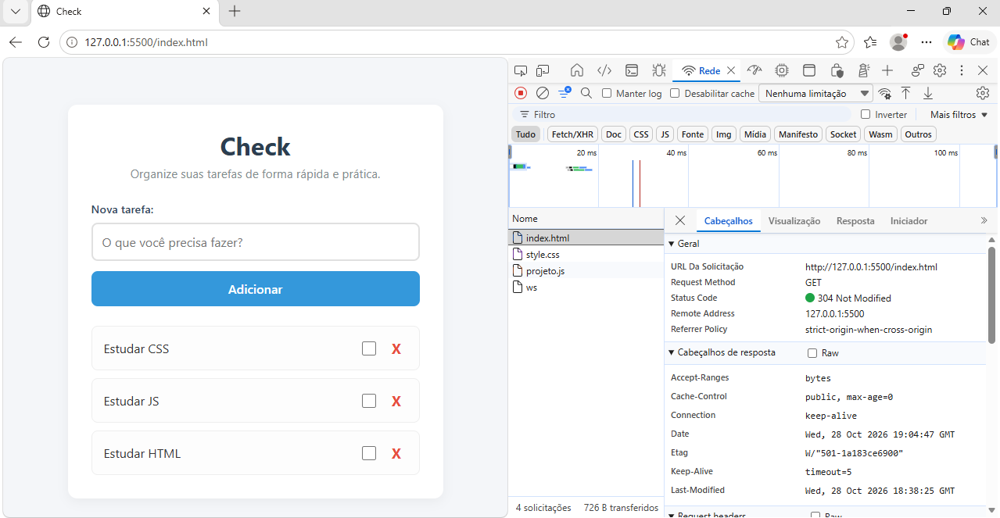

# Check — Lista de Tarefas

O **Check** é uma aplicação web moderna, leve e intuitiva desenvolvida para a gestão e organização de tarefas diárias. O projeto foca em alta performance, usabilidade responsiva e armazenamento local persistente.

## 🚀 O que a Aplicação Faz

* **Adição de Tarefas:** Permite criar novas tarefas de forma rápida através de um campo de entrada com validação de texto em branco.

* **Marcação de Conclusão:** Permite marcar e desmarcar tarefas como concluídas via *checkbox*, aplicando feedback visual dinâmico (texto riscado e fundo destacado).

* **Remoção de Tarefas:** Permite excluir tarefas individualmente da lista através de um botão dedicado.

* **Persistência de Dados (LocalStorage):** Salva o estado atual das tarefas no navegador. Mesmo ao fechar ou recarregar a página, as tarefas permanecem armazenadas.

* **Interface Responsiva & Segura:** Layout adaptável para dispositivos móveis e desktop, desenvolvido com foco na prevenção de vulnerabilidades de segurança (XSS).

## 🛠️ Tecnologias Utilizadas

* **HTML5:** Estruturação semântica e acessível.

* **CSS3:** Estilização moderna com Flexbox, variáveis visuais, transições e resets padronizados.

* **JavaScript (ES6+):** Manipulação dinâmica do DOM, tratamento de eventos, funções CRUD e gestão de dados com `localStorage`.

## 💻 Como Executar o Projeto

Como a aplicação é estática e roda diretamente no navegador, não é necessária a instalação de dependências ou servidores complexos.

1. **Clonar o repositório:**

   ```bash
   git clone https://github.com/herickvini143-ux/Check---Lista-de-Tarefas.git
   ```

2. **Navegar até a pasta do projeto:**

   ```bash
   cd Check---Lista-de-Tarefas
   ```

3. **Abrir no navegador:**

   * Basta dar um duplo clique no ficheiro `index.html`, ou

   * Executar com a extensão **Live Server** no Visual Studio Code.

## 🤖 Uso de Inteligência Artificial

A Inteligência Artificial foi utilizada ao longo do desenvolvimento como uma ferramenta colaborativa de **mentoria, geração estrutural e auditoria de código**, com os seguintes focos:

* **Desenvolvimento Estrutural do CSS:** Geração e estruturação da base do arquivo `style.css` (reset global, layout dinâmico com Flexbox, responsividade e estados visuais como `.feito`), garantindo uma interface limpa e moderna.

* **Revisão de Boas Práticas & Segurança:** Validação do uso de `textContent` em vez de `innerHTML` para a inserção de textos dinâmicos inseridos pelo utilizador, prevenindo ataques de *Cross-Site Scripting* (XSS).

* **Refatoração & Clean Code:** Refinamento dos nomes de variáveis, remoção de logs de depuração desnecessários e padronização da nomenclatura de iterações (`tarefa` no singular dentro do `forEach`).

* **Documentação & Comentários:** Ajuda na estruturação de comentários informativos no HTML, CSS e JavaScript, garantindo legibilidade técnica.

* **Gestão do Histórico do Git:** Orientação no fluxo de commits incrementais e descritivos para manter um histórico limpo e profissional no repositório.

* **Ferramenta Utilizada:** A ferramenta utilizada para esse projeto foi o **Google Gemini.**
  

## 🌐 Evidência de Rede (Network)

Teste de verificação de requisição efetuado na aba Network (Rede) do navegador através de servidor HTTP local.


